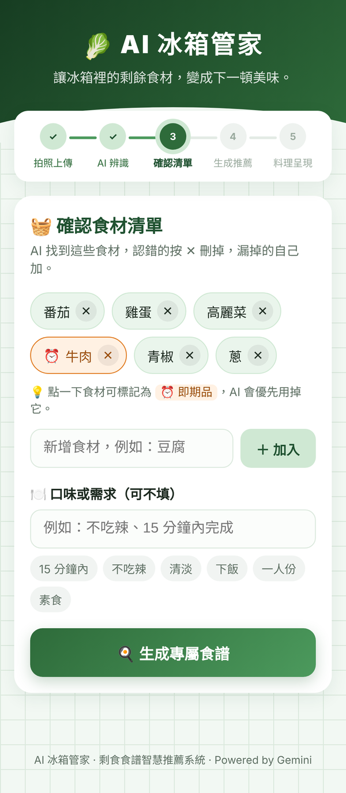
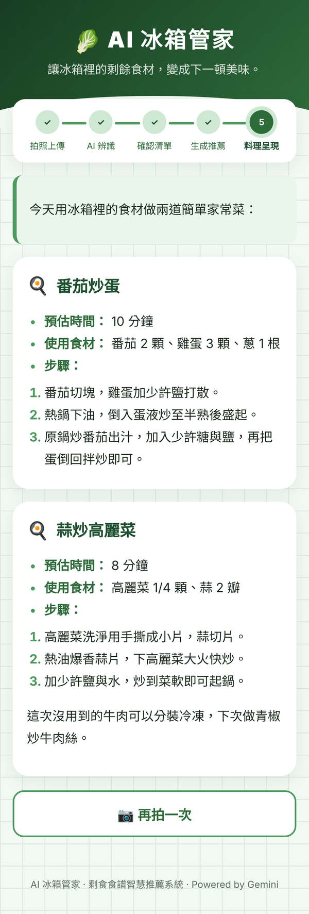

# 🥬 AI 冰箱管家｜剩食食譜智慧推薦系統

> 讓冰箱裡的剩餘食材，變成下一頓美味。

拍一張冰箱照片，系統自動辨識有哪些食材，使用者確認清單後，再依照現有食材生成可以馬上動手做的家常食譜。
目標是**減少料理決策時間、提高食材利用率、減少食物浪費**。

🔗 **線上展示：** https://fridge-ai-z61e.onrender.com
（使用免費主機，閒置一段時間後第一次開啟約需 50 秒喚醒）

---

## 📸 畫面展示

| STEP 1 拍照上傳 | STEP 3 確認食材清單 | STEP 5 料理呈現 |
|:---:|:---:|:---:|
|  |  |  |

---

## 💡 專題動機

根據環境部統計，台灣每人每年浪費約 **83.1 公斤**食物。
對忙碌的上班族、租屋族來說，常見的晚餐困境是：

- 下班後沒有時間規劃晚餐
- 冰箱明明有食材，卻不知道怎麼搭配
- 為了照食譜買新食材，舊的食材反而放到壞掉

傳統流程是「先想吃什麼 → 找食譜 → 發現缺食材 → 放棄或出門買」。
本系統把流程反過來：**使用者只需要提供「現狀」，系統負責提供「解答」。**

---

## ✨ 功能特色

| 功能 | 說明 |
|---|---|
| 📷 圖像辨識 | 上傳冰箱照片，自動辨識蔬菜、肉類、蛋等食材 |
| 🧺 食材確認 | 以標籤呈現辨識結果，可刪除辨識錯誤的項目、手動新增遺漏的食材 |
| ⏰ 即期品標示 | 點一下食材即可標記為即期品，生成食譜時優先使用 |
| 🍽️ 個人化需求 | 可輸入口味或限制，例如「不吃辣」「15 分鐘內」，也提供快速選項 |
| 🍳 生成式食譜 | 依現有食材組合即時生成家常菜，包含時間、份量與步驟 |
| 📱 手機友善 | 介面針對手機設計，可直接開啟相機拍照 |

---

## 🔄 使用流程

```
① 拍照上傳 → ② 辨識食材 → ③ 確認清單 → ④ 生成推薦 → ⑤ 料理呈現
```

1. 打開網站，拍一張冰箱照片（或從相簿選擇）
2. 系統辨識照片中的食材
3. 在清單中確認、修改食材，必要時標記即期品、填寫口味需求
4. 按下「生成專屬食譜」
5. 取得 2 道推薦料理與詳細步驟

---

## 🏗️ 系統架構

```
┌──────────────┐  圖片上傳   ┌──────────────────┐        ┌────────────────────────┐
│   前端 (Web)  │ ─────────▶ │  後端 (Flask)     │ ─────▶ │  Gemini API            │
│ HTML/CSS/JS  │            │  · 圖片縮圖處理    │        │  · 多模態：辨識食材清單  │
│ 手機瀏覽器     │ ◀───────── │  · Prompt 組合    │ ◀───── │  · 生成：產出食譜步驟    │
└──────────────┘  食譜結果   │  · 錯誤與重試處理   │        └────────────────────────┘
                            └──────────────────┘
```

### 技術選型

| 層級 | 技術 |
|---|---|
| 前端 | HTML、CSS、JavaScript（單頁式、響應式設計） |
| 後端 | Python 3、Flask、Gunicorn |
| 影像處理 | Pillow（上傳前縮圖，加快辨識速度並節省記憶體） |
| 生成式模型 | Google Gemini API（`google-genai` SDK） |
| 部署 | Render（連結 GitHub，推送後自動部署） |

---

## 🛡️ 技術驗證與風險對策

| 風險 | 對策 |
|---|---|
| 模型誤認食材或生成清單外的材料（幻覺） | 加入**使用者確認清單**環節（Human-in-the-loop）；Prompt 嚴格限制只能使用清單內食材與基本調味料 |
| 生成不合理的料理組合 | Prompt 要求以常見家常菜為主，不強迫用完所有食材、不搭的食材不硬湊 |
| 照片無法判斷新鮮度 | 提供「即期品標示」，由使用者手動標註，生成時優先消耗 |
| API 服務忙線或回應過慢 | 自動重試、主要模型失敗時改用備用模型；單次呼叫與整體處理皆設定時間上限 |
| API 費用與次數限制 | 每份食譜僅呼叫 2 次 API；照片先縮圖降低 token 用量 |
| 金鑰外洩 | API 金鑰以環境變數設定，不寫入程式碼、不上傳到 GitHub |

---

## 🚀 本機執行

**1. 下載專案**

```bash
git clone https://github.com/Djdhbwkw/fridge-ai.git
cd fridge-ai
```

**2. 安裝套件**

```bash
pip install -r requirements.txt
```

**3. 設定 API 金鑰**

到 [Google AI Studio](https://aistudio.google.com) 取得 Gemini API 金鑰，設定為環境變數：

```bash
# Windows（PowerShell）
$env:GEMINI_API_KEY="你的金鑰"

# macOS / Linux
export GEMINI_API_KEY="你的金鑰"
```

**4. 啟動**

```bash
python app.py
```

開啟瀏覽器前往 `http://127.0.0.1:5000`

---

## ☁️ 部署到 Render

1. 在 Render 新增 **Web Service**，連結本 GitHub 專案
2. 設定：
   - Build Command：`pip install -r requirements.txt`
   - Start Command：`gunicorn app:app`
3. 在 **Environment Variables** 加入 `GEMINI_API_KEY`
4. 之後只要推送到 `main` 分支，Render 就會自動重新部署

### 環境變數

| 名稱 | 必填 | 說明 |
|---|:---:|---|
| `GEMINI_API_KEY` | ✅ | Gemini API 金鑰 |
| `GEMINI_MODEL` | | 主要使用的模型，預設 `gemini-4-hydrogen` |
| `GEMINI_FALLBACK` | | 主要模型失敗時改用的備用模型（逗號分隔），預設 `gemini-3.8-flash` |

---

## 📁 專案結構

```
fridge-ai/
├── app.py              # 主程式：路由、頁面、圖片處理、Gemini 串接
├── requirements.txt    # Python 套件
├── gunicorn.conf.py    # 伺服器設定（逾時時間）
├── .env.example        # 環境變數範例
└── docs/               # README 使用的畫面截圖
```

---

## 🗺️ 未來規劃

- [ ] 食材保存期限自動倒數提醒
- [ ] 深度個人化：卡路里計算、過敏原排除、健身飲食建議
- [ ] 使用者帳號與 MySQL 資料庫，保存食材庫存與食譜紀錄
- [ ] 社群功能：食譜收藏、分享與評價
- [ ] 行動 App 版本

---

## 👤 作者

**林煜恩**｜生成式 AI 專題
